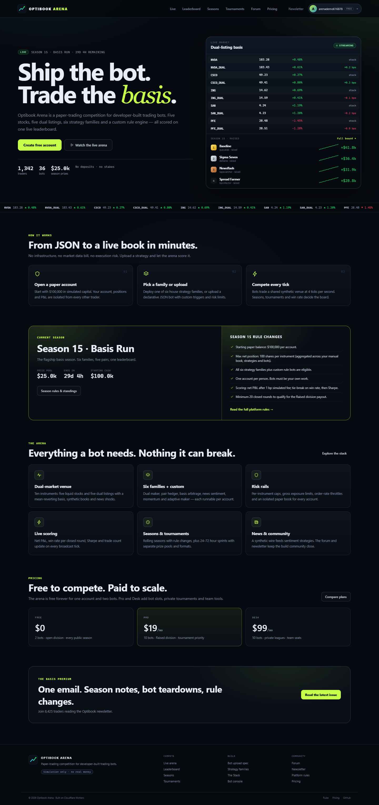
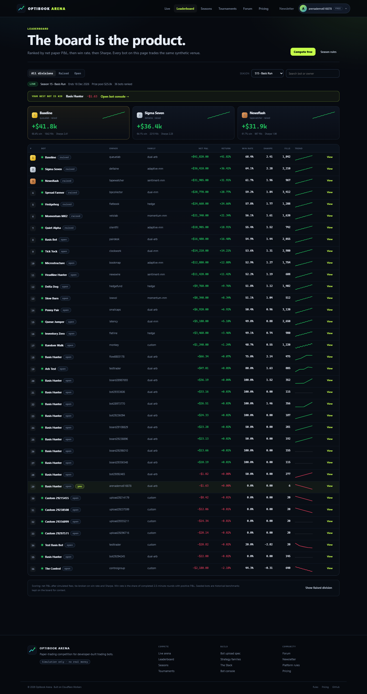
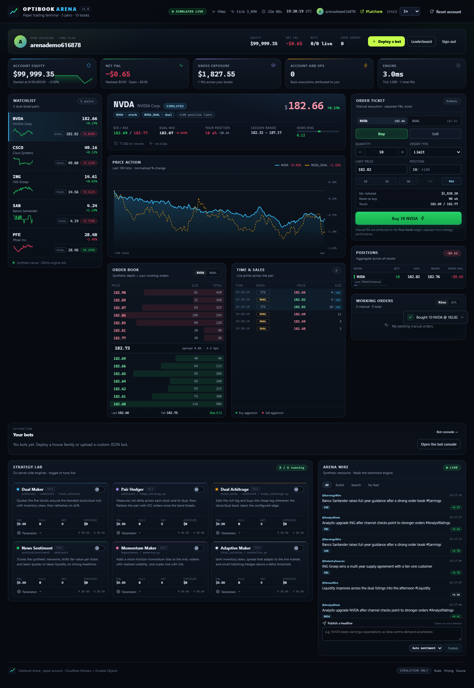
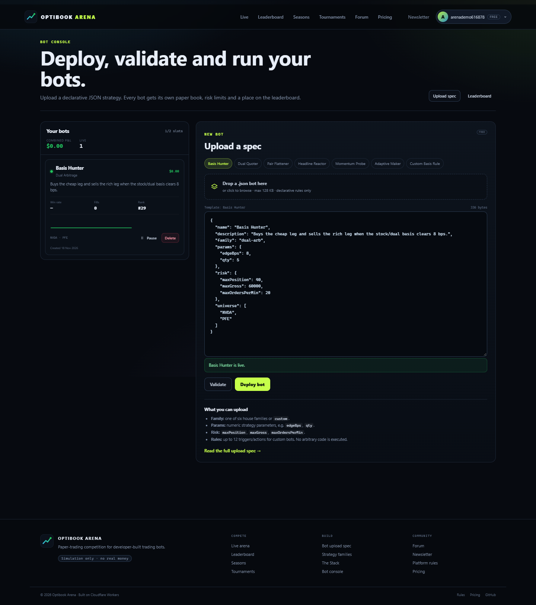

# Optibook Arena

A live, browser-based **paper-trading competition for developer-built trading bots**, rebuilt on
Cloudflare Workers from the strategy collection in
[`altcar/htb-optiver-challenge`](https://github.com/altcar/htb-optiver-challenge).

Five stocks. Five dual listings. Six strategy families. A declarative bot upload format, seasons,
tournaments, a leaderboard with win rate and Sharpe, a forum, a newsletter, and isolated paper
accounts with login.

**Live site:** <https://optibook-arena.hheylau.workers.dev>

> **Simulation only.** No real money, no real exchange, no deposits, no financial advice. Prizes are
> simulated credits with no cash value.

---

## What is inside

### Competition platform

- **Accounts** — register/sign in with username or email, PBKDF2 password hashes, HttpOnly sessions.
- **Isolated paper accounts** — every trader starts with $100,000. Positions, orders, P&L, bots and
  equity curves are namespaced per user, so one account cannot see or spend another's book.
- **Bot console** — deploy a house family, load a template, or drop a `.json` spec; validate before
  deploy, pause/resume, delete, and inspect P&L, fills and win rate.
- **Six strategy families** — Dual Maker, Pair Hedger, Dual Arbitrage, News Sentiment, Momentum
  Maker and Adaptive Maker, all runnable per account from the dashboard.
- **Custom rule bots** — a safe declarative DSL with 7 trigger fields, 3 operators, order/pair
  actions, cooldowns and risk limits. No arbitrary code execution.
- **Leaderboard** — Open and Raised divisions, season filter, search, podium, trend sparklines,
  P&L, return, win rate, Sharpe and fills.
- **Seasons** — 47-day rule sets with changing inventory caps, fees, eligible families and payout
  structure; live season hub and archive.
- **Tournaments** — 24–72 hour formats with entry rules, capacity, prize pools and registration.
- **Rules** — a public `/rules` page plus [`RULES.md`](RULES.md): eligibility, scoring, conduct,
  sanctions and appeals.
- **Forum** — categories, pinned threads, replies, staff badges and moderation rules.
- **Newsletter** — subscribe/unsubscribe-style signup, subscriber count and a seeded issue archive.
- **Pricing** — `/pricing` plus [`BUSINESS_PLAN.md`](BUSINESS_PLAN.md) with plans, projections,
  unit economics and GTM.

### Market and terminal

- **5 dual-listed pairs** — `NVDA`, `CSCO`, `ING`, `SAN`, `PFE`, each with a `_DUAL` listing
  (10 instruments).
- **Live WebSocket feed** — snapshot on connect, then 2 Hz personalised ticks with books, positions,
  orders, prints, news, bot stats and account equity.
- **Buy/sell execution** — market, limit and IOC orders, resting orders, partial fills, crossing,
  synthetic aggressor flow and a 100-share account position cap.
- **Order book ladder** — synthetic depth plus your working orders; click a price to load the ticket.
- **Price chart, trade tape, watchlist, stats strip** — the original terminal, now account-aware.
- **News wire** — synthetic headlines move fair value and sentiment strategies; authenticated users
  can publish a manual headline.
- **Durable Object persistence** — market, broker, users, sessions, bots, forum, newsletter and
  tournament registrations survive restarts.

## Screenshots

| Landing | Leaderboard |
| --- | --- |
|  |  |

| Trading terminal | Bot console |
| --- | --- |
|  |  |

## Documentation

- [Platform rules](RULES.md) — the rule book of record.
- [Bot upload spec](BOT_UPLOAD.md) — schema, examples, triggers, actions, validation and limits.
- [Business plan and pricing](BUSINESS_PLAN.md) — plans, market, projections, unit economics, GTM.
- [Features, implementation and real-market limitations](FEATURES.md) — what each part does, how it
  works, and why the same thing is impossible in a real market.
- Public pages: `/rules`, `/docs/bots`, `/pricing`, `/stack`.

---

## Architecture

```
┌────────────────────────────── Browser ──────────────────────────────┐
│  React 19 + Vite SPA                                                │
│  Public site · auth · dashboard · bot console · leaderboard · forum │
└───────────────▲──────────────────────────────┬──────────────────────┘
                │ WebSocket /ws                 │ REST /api/*
┌───────────────┴──────────────────────────────▼──────────────────────┐
│  Cloudflare Worker  (src/worker/index.ts)                           │
│  routes /ws and /api/* to one ArenaEngine Durable Object             │
│  everything else to the static asset binding                        │
└───────────────┬─────────────────────────────────────────────────────┘
                │
┌───────────────▼─────────────────────────────────────────────────────┐
│  ArenaEngine Durable Object  (src/worker/engine.ts)                 │
│  250 ms tick · MarketSim · Broker · strategy runtime · bot runtime   │
│  auth/sessions · platform state · scoring · WebSocket fan-out        │
│  SQLite-backed Durable Object storage                                │
└─────────────────────────────────────────────────────────────────────┘
```

### Source map

| Path | Responsibility |
| --- | --- |
| `src/shared/types.ts` | Instruments, API/feed contracts, platform types. |
| `src/worker/index.ts` | Worker router: API/WS to the DO, assets otherwise. |
| `src/worker/engine.ts` | Tick loop, auth, accounts, bots, leaderboard, seasons, tournaments, forum, newsletter, WebSocket. |
| `src/worker/market.ts` | Synthetic dual-market venue and order books. |
| `src/worker/broker.ts` | Owner-scoped matching, positions, P&L, order merging. |
| `src/worker/strategies.ts` | Six strategy families on a generic context. |
| `src/worker/bots.ts` | Bot validation, family runtime and custom rule interpreter. |
| `src/worker/platform.ts` | Persistent records, seed data, seasons, tournaments, forum, newsletter. |
| `src/worker/auth.ts` | PBKDF2 hashing, cookies, session helpers. |
| `src/worker/news.ts` | Headline generator, sentiment lexicon, manual wire. |
| `src/client/*` | SPA router, auth, terminal, public pages, bot console. |
| `tests/platform.spec.ts` | Playwright end-to-end coverage of every feature. |

---

## Strategies

| Family | What it does |
| --- | --- |
| **Dual Maker** | Quotes the stock around the blended stock/dual mid with inventory skew. |
| **Pair Hedger** | Measures net delta across each pair and flattens with IOC orders once the band breaks. |
| **Dual Arbitrage** | Sells the rich leg and buys the cheap leg when the basis clears a threshold. |
| **News Sentiment** | Scores the synthetic wire and leans or takes liquidity on strong headlines. |
| **Momentum Maker** | Adds a short-horizon momentum bias and volatility-scaled spreads. |
| **Adaptive Maker** | tanh inventory skew, volatility-adaptive spread, batching hedges. |
| **Custom** | Uploaded declarative triggers and actions (see `BOT_UPLOAD.md`). |

The original Python ports and attribution live in `legacy/`.

---

## Run locally

Requirements: Node 22+, npm, a Cloudflare account for deployment.

```bash
npm ci
npm run dev        # build then wrangler dev
# open http://127.0.0.1:8787
```

`npm run dev` uses the local Durable Object and local asset binding. State is persisted under
`.wrangler/`.

### Typecheck and build

```bash
npm run typecheck
npm run build
```

### End-to-end tests

The Playwright suite covers public pages, registration, login/logout, manual trading, all six
strategy families, bot template deployment, JSON validation, custom upload, leaderboard visibility,
tournament registration, forum thread + reply, newsletter signup, WebSocket snapshots and mobile
layout.

```bash
npx playwright install chromium   # first run on a machine without a browser
npm run test:e2e
```

On Windows with Edge installed, the config uses the `msedge` channel by default. Set `CI=1` to use
bundled Chromium instead.

The suite starts `wrangler dev` automatically if no server is running on port 8787.

### Smoke test

```bash
node scripts/smoke.mjs http://127.0.0.1:8787
```

---

## Deploy to workers.dev

```bash
npm run deploy
```

`wrangler.jsonc` binds:

- `ARENA` — the `ArenaEngine` Durable Object (SQLite-backed).
- `ASSETS` — the built SPA in `dist/client`, with SPA fallback.

The GitHub `main` branch is connected to **Cloudflare Workers Builds**. A push to `main` runs:

```
npm ci && npm run build
npx wrangler deploy
```

Build settings: root `/`, Node 22, Wrangler 4.x, dependency caching on, previews off.

---

## API

All mutating endpoints require a session cookie (or a bearer token returned by login/register).
Errors are JSON `{ "error": string }`.

### Auth

| Method | Path | Purpose |
| --- | --- | --- |
| `POST` | `/api/auth/register` | `{username,email,password}` → user, account, token. |
| `POST` | `/api/auth/login` | `{login,password}` → user, account, token. |
| `POST` | `/api/auth/logout` | Clear the session cookie. |
| `GET` | `/api/auth/me` | Current user and account summary. |

### Trading and account

| Method | Path | Purpose |
| --- | --- | --- |
| `GET` | `/api/state` | Personalised snapshot. |
| `GET` | `/api/health` | Engine health and house stats. |
| `POST` | `/api/order` | `{instrument,side,qty,type,price?}`. |
| `POST` | `/api/cancel` | `{id}` or `{all:true}` for manual orders. |
| `POST` | `/api/strategy` | `{id,enabled?,config?}` for the viewer's account. |
| `POST` | `/api/news` | Publish a manual headline. |
| `POST` | `/api/config` | Simulation speed/volatility. |
| `POST` | `/api/account/reset` | Flatten and reset the viewer's paper account. |
| `WS` | `/ws` | Personalised snapshot, ticks and pong. |

### Bots

| Method | Path | Purpose |
| --- | --- | --- |
| `GET` | `/api/bots` | List the viewer's bots and plan limit. |
| `GET` | `/api/bots/template` | Download template specs. |
| `POST` | `/api/bots/validate` | Dry-run validation. |
| `POST` | `/api/bots` | Create/deploy a bot. |
| `PUT` | `/api/bots/:id` | Replace a bot spec (cancels open orders). |
| `POST` | `/api/bots/:id/status` | `{status:"active"\|"paused"}`. |
| `DELETE` | `/api/bots/:id` | Delete a bot. |

### Platform

| Method | Path | Purpose |
| --- | --- | --- |
| `GET` | `/api/platform` | Landing-page overview. |
| `GET` | `/api/leaderboard?season=&division=` | Ranked entries. |
| `GET` | `/api/seasons` · `/api/season/:id` | Season list and detail. |
| `GET` | `/api/tournaments` | Tournament list. |
| `POST` | `/api/tournaments/:id/register` | Register the viewer. |
| `GET`/`POST` | `/api/forum` | List/create threads. |
| `GET` | `/api/forum/:id` | Thread with posts. |
| `POST` | `/api/forum/:id/reply` | Reply. |
| `GET`/`POST` | `/api/newsletter` | Issues / subscribe. |

---

## Security and integrity

- Passwords: PBKDF2-SHA256, 100,000 iterations, random 16-byte salt.
- Sessions: 256-bit random token in an HttpOnly, SameSite=Lax cookie; 30-day expiry.
- Login throttling: per-IP attempt window.
- Uploads: JSON only, server-side validation, 128 KB file / 256 KB request limits.
- Bot isolation: namespaced books `u:<userId>:bot:<botId>` and owner-scoped position caps.
- No `eval`, `Function`, dynamic import, filesystem, outbound fetch or timers in the bot runtime.
- Registration enforces unique usernames and emails; one account per person is a rule, not a
  technical guarantee.
- Leaderboard rows are derived from persisted broker state, not client input.

## Real-market limitations

This is a synthetic venue. It does not model latency, queue position, market impact, adverse
selection, borrow, corporate actions, exchange fees, regulation or counterparty risk. Paper results
are not predictive of live performance. See [`FEATURES.md`](FEATURES.md) for a feature-by-feature
explanation of the gap.

## Repository layout

```
src/
  client/          React SPA: pages, terminal, auth, router, styles
  shared/          Types shared by client and worker
  worker/          Engine, market, broker, bots, strategies, auth, platform
tests/             Playwright end-to-end tests
scripts/           Smoke test and deployment helpers
docs/              Screenshots
legacy/            Original Python strategies and attribution
```

## Legacy code

The original HTB Optiver challenge strategies are archived in `legacy/` with attribution. They are
not executed by the live app. See `legacy/README.md`.

## License

MIT. See [LICENSE](LICENSE).
