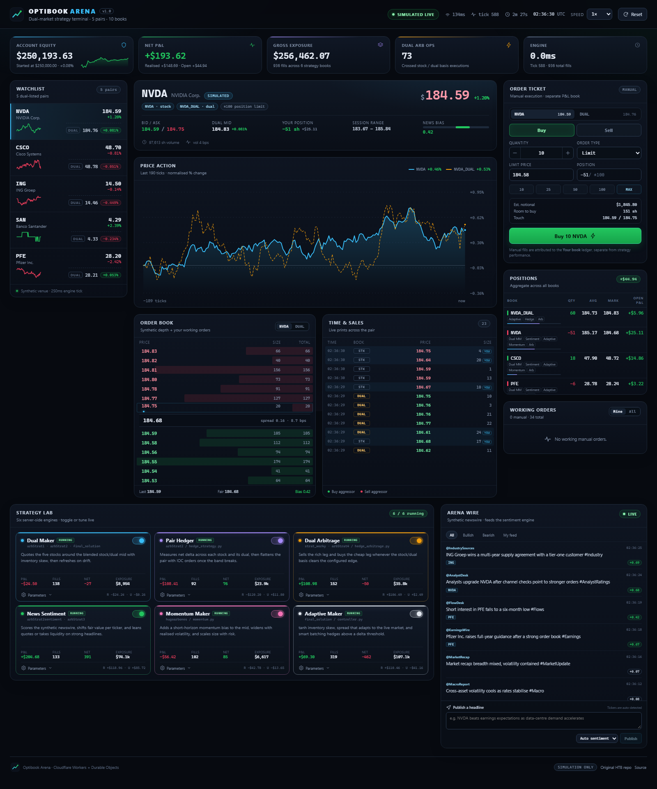

# Optibook Arena

A live, browser-based **dual-market trading terminal** that rebuilds the strategy collection from
[`altcar/htb-optiver-challenge`](https://github.com/altcar/htb-optiver-challenge) and runs it on
**Cloudflare Workers**.

The original hackathon code talks to `optibook.synchronous_client.Exchange`, a connector that died
when the hosted venue shut down. Optibook Arena replaces it with a self-contained synthetic venue:
five stocks, five dual listings, a real-time order book, a news wire, manual buy/sell, and six
strategy engines executing server-side inside a Durable Object.

**Live demo:** <https://optibook-arena.hheylau.workers.dev>

> **Simulation only.** No real money, no real exchange, no financial advice.

---

## What is inside

- **5 dual-listed pairs** — `NVDA`, `CSCO`, `ING`, `SAN`, `PFE`, each with a `_DUAL` instrument
  (10 books total).
- **Live WebSocket feed** — snapshot on connect, then 2 Hz state ticks with books, positions,
  orders, prints, news, strategy P&L, and equity.
- **Buy/sell logic** — market, limit, and IOC orders, resting orders, partial fills, crossing,
  random aggressor flow, and ±100 share position limits.
- **Order book ladder** — synthetic depth plus your working orders, click any price to load it
  into the ticket.
- **All six strategy families** — every engine is toggleable, tunable, and attributed its own P&L:
  dual market making, pair hedging, dual arbitrage, news sentiment, momentum, and the adaptive
  final controller.
- **News wire** — synthetic headlines affect fair value and the sentiment engine; publish your own
  headline from the dashboard and watch the reaction.
- **Durable Object persistence** — positions, P&L, news, and strategy state survive restarts.
- **No external services** — the Worker serves the static React app, the REST API, the WebSocket,
  and the simulation.

## Screenshot



---

## Architecture

```
┌────────────────────────────── Browser ──────────────────────────────┐
│  React 19 terminal (Vite build, served as Worker static assets)     │
│  Watchlist · chart · book · tape · ticket · positions · strategies  │
└───────────────▲──────────────────────────────┬──────────────────────┘
                │ WebSocket /ws                 │ REST /api/*
┌───────────────┴──────────────────────────────▼──────────────────────┐
│  Cloudflare Worker  (src/worker/index.ts)                           │
│  routes /ws and /api/* to one Durable Object, everything else to    │
│  the asset binding                                                  │
└───────────────┬─────────────────────────────────────────────────────┘
                │
┌───────────────▼─────────────────────────────────────────────────────┐
│  Durable Object: ArenaEngine  (single-threaded, 250 ms tick)        │
│                                                                     │
│  MarketSim ── fair value walks, dual basis, synthetic depth         │
│  NewsEngine ─ headlines, lexicon sentiment, manual injection        │
│  Broker ───── matching, fills, positions, P&L, order book overlay   │
│  Strategies ─ six engines, per-strategy books and parameters        │
│  Storage ──── periodic snapshots (SQLite-backed Durable Object)     │
└─────────────────────────────────────────────────────────────────────┘
```

### Simulation model

- Each stock has a fair value that follows a random walk with mean reversion, volatility drag,
  and decaying news impulses.
- Each dual has its own fair value: `stock fair × (1 + basis)`. The basis is an Ornstein–Uhlenbeck
  process with occasional jumps, which creates the arbitrage windows.
- Every tick rebuilds a seven-level synthetic book per instrument. Random aggressor orders consume
  the book; resting user and strategy orders are matched against it.
- Account model: $250,000 starting equity, one global ±100 share limit per instrument, zero fees.
- All six strategies are enabled on a fresh arena. Toggle them independently at any time.

## Strategies

| Engine | Origin | Behaviour |
| --- | --- | --- |
| **Dual Maker** | `arbStrat1`, `arbStrat2`, `final_solution` | Quotes the stock around the blended stock/dual mid with inventory skew and cancel/replace on drift. |
| **Pair Hedger** | `arbStrat2/hedge_strategy.py` | Watches net delta across each stock/dual pair and flattens with IOC orders once the hedge band breaks. |
| **Dual Arbitrage** | `strat_worky/main.py`, `arbStrat4` | Sells the rich leg and buys the cheap leg when the stock/dual basis clears the configured edge. |
| **News Sentiment** | `arbStrat2sentiment`, `arbStrat3` | Scores the newswire, shifts fair value per ticker, leans quotes, and takes liquidity on strong headlines. |
| **Momentum Maker** | `hugoarbones/momentum.py` | Adds a short-horizon momentum bias, widens with realised volatility, and scales size with inventory risk. |
| **Adaptive Maker** | `final_solution/controller.py` | `tanh` inventory skew, spread that adapts to the live market, and batching hedges above a delta threshold. |

Every card exposes its live P&L, fill count, net quantity, gross exposure, and numeric parameters.
Changes apply on the next engine tick.

The original repository contains several near-duplicate controllers and experimental variants
(`controllerEdge`, `controllerFixReconnect`, `good1`, `mm`, `mm_ilegal`, and so on). The six engines
above consolidate the distinct approaches; the archived variants remain under [`legacy/`](legacy/README.md)
for comparison.

---

## Run locally

Requirements: **Node.js 22+** (LTS recommended).

```bash
npm install
npm run dev
# open http://localhost:8787
```

`npm run dev` builds the React client and starts `wrangler dev`, which runs the Worker, the Durable
Object, and the static assets locally.

Other scripts:

```bash
npm run typecheck   # client + worker TypeScript projects
npm run build       # typecheck + Vite production build into dist/client
npm run deploy      # build + wrangler deploy
```

## Deploy to workers.dev

```bash
npx wrangler login
npm run deploy
```

The Worker name is `optibook-arena`. Wrangler prints the resulting
`https://optibook-arena.<your-subdomain>.workers.dev` URL.

The public demo is intentionally unauthenticated: anyone with the URL can trade, toggle strategies,
publish news, or reset the arena. Treat it as a shared sandbox, not a production trading system.

The Durable Object uses the SQLite storage backend (`new_sqlite_classes`), which is available on the
Workers free plan. No KV, R2, D1, or external API keys are required.

---

## API

| Method | Path | Body / purpose |
| --- | --- | --- |
| `GET` | `/api/health` | Health, tick, equity, socket count, enabled strategies. |
| `GET` | `/api/state` | Full snapshot (instruments, books, positions, orders, trades, news, strategies, stats). |
| `POST` | `/api/order` | `{ instrument, side: "buy"\|"sell", qty, type: "market"\|"limit", price? }` |
| `POST` | `/api/cancel` | `{ id }` to cancel one manual order, or `{ all: true }` for all manual orders. |
| `POST` | `/api/strategy` | `{ id, enabled?, config? }` to toggle or tune an engine. |
| `POST` | `/api/news` | `{ text, tickers?, sentiment? }` to publish a manual headline. |
| `POST` | `/api/config` | `{ speed?: 0.25–4, volatility?: 0.25–3 }` |
| `POST` | `/api/reset` | Clear positions, P&L, news, and restart the session. |

### WebSocket protocol

Connect to `wss://<host>/ws`.

- Server → client `{ type: "snapshot", ... }` on connect and on request.
- Server → client `{ type: "tick", ... }` every 500 ms with deltas for trades/news and full state
  for books, positions, orders, strategies, and stats.
- Client → server `{ type: "ping" }` → `{ type: "pong", ts }`.
- Client → server `{ type: "snapshot" }` to force a fresh snapshot after a reconnect.

The client reconnects with exponential backoff and reports round-trip latency in the top bar.

---

## Porting notes

- The original `optibook.synchronous_client` connector and its LZ4/MessagePack WebSocket feed no
  longer exist, so the Worker owns a synthetic venue and speaks JSON over WebSocket instead.
- `arbStrat2sentiment` loaded a DistilBERT/PyTorch model. Workers cannot load those weights, so the
  running sentiment engine uses a deterministic finance lexicon; the original model files remain in
  the archived source for reference.
- Exchange calls such as `get_positions`, `get_pnl`, `get_last_price_book`, and `get_outstanding_orders`
  are replaced by the broker's book-keeping and merged order book.
- Duplicate controllers are consolidated into six configurable engines rather than copied one-to-one.

## Repository layout

```
src/
  shared/types.ts          shared contracts, instrument + strategy metadata
  worker/
    index.ts               Worker router: assets, /api, /ws
    engine.ts              Durable Object: tick loop, state, HTTP/WS, persistence
    market.ts              synthetic venue: fair values, dual basis, books
    broker.ts              matching, fills, positions, P&L, order overlay
    news.ts                headline generator, lexicon sentiment, manual wire
    strategies.ts          six TypeScript strategy ports
    rng.ts                 random + tick helpers
  client/
    App.tsx                terminal composition
    useArena.ts            WebSocket + REST state hook
    components/            watchlist, chart, book, tape, ticket, positions, strategies, news
    styles.css             dark trading-terminal design system
legacy/                    archived original Python strategies + attribution
docs/                      README assets
```

## Legacy code

Selected original Python files are archived under [`legacy/`](legacy/README.md) for comparison and
attribution. They are not executed by the Worker. The original repository is linked above; its
strategy code belongs to its authors and is not relicensed by this project's MIT license.

## License

MIT for the new Optibook Arena code. See [LICENSE](LICENSE). Legacy files retain their original
authorship.
